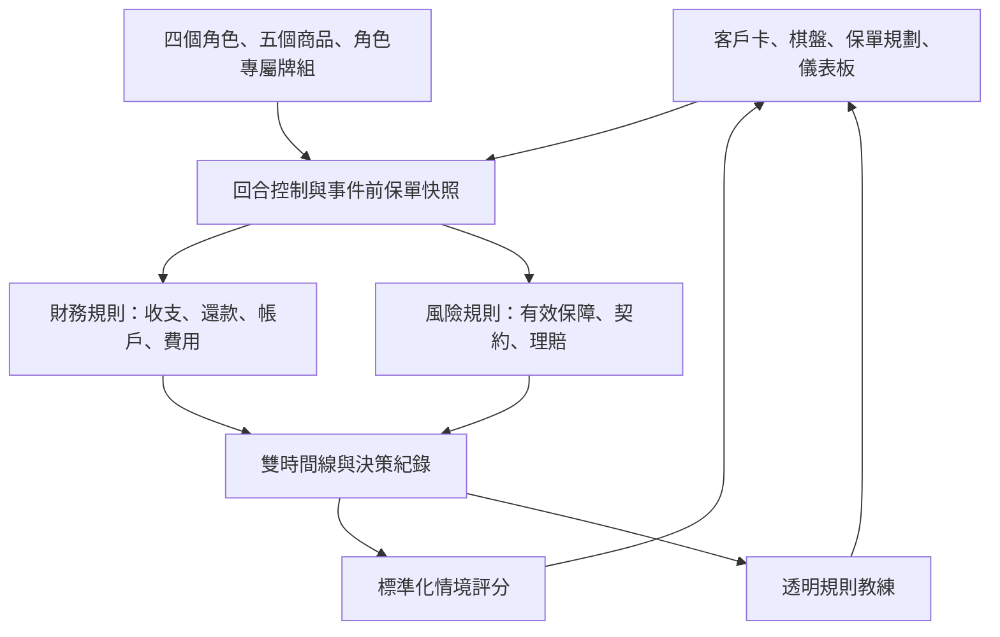

# LifeRisk 保險大富翁：需求導向的保險決策 MVP

玩家是新人理專，客戶是虛構個案。目標是在可持續的預算中辨識需求、選擇保障、理解契約，最後分開看財務成果與學習表現。

## 架構

`academy-engine.js` 可在瀏覽器及 Node.js 執行，與 DOM 完全獨立。`academy.js` 只負責畫面、輸入與 JSON 匯出。金融計算不由語言模型決定。

## 回合與章節

1. 選角色即開局；角色預設的兩項優先需求寫入決策紀錄。
2. 規劃：增加或減少商品單位；當回合事件前生效。
3. 擲骰：移動 1–6 格。按落點決定類別，再從該客戶的牌組獨立抽卡；同類優先選尚未使用的卡。
4. 結算一年：收入 → 生活費、還款及年繳 → 帳戶扣費與累積 → 市場變動 → 事件損失與給付 → 往後年度參數調整。年齡加一。
5. 保單鎖定，顯示條款判定、帳務、同事件雙現金路徑及適用的選答題。
6. 觀念題可選答，確認結算後重新開放規劃。
7. 六回合後顯示本局財務與學習成果報告。

每位客戶有九張卡，涵蓋四類事件。身故後由家屬承接餘下回合，改抽家庭情境卡。

## 財務假設

- 金額為新台幣整數。虛構角色參數可在 `roles` 調整。
- 負債年利率固定 2%；還款先計利息，再還本金，不因還本金重複扣除淨資產。
- 現金不足先賣一般投資，仍不足則新增緊急借款並記錄 `shortfall`。不自動賣房或解約保單。
- 市場卡僅改變一般投資與投資型帳戶，沒有另加未揭露的基準報酬。
- 生活費變動、升職與失能改變下一年度參數；失業卡直接扣當年半年工作收入。
- 身故發生在年度收支結算後。身故給付作為家屬資源；之後停止工作收入與客戶保費，讓家屬繼續完成局數。
- 既有壽險假設已繳清，不再收費；歷史保費不在本局模型範圍。

## 五種虛構契約

| 商品 | 每單位年繳 | 效果與限制 |
| --- | ---: | --- |
| 家庭守護／定期壽險 | 12,000 | 身故 300 萬，最多 3 單位。失業、失能不給付。 |
| 安心醫療／健康險 | 18,000 | 住院費用每單位上限 8 萬，最多 2 單位；總給付不得超過實際住院費。門診不給付。 |
| 意外防線／意外險 | 6,000 | 意外醫療上限 5 萬、意外失能定額 30 萬、意外身故 100 萬，最多 1 單位。本版事件卡的身故為疾病，故不觸發意外身故。 |
| 成長同行／投資型保險 | 30,000 | 最多 2 單位。每單位投入費 900、管理費 600、保障成本 900，剩餘進帳戶；每年扣帳戶 1%，再按市場卡波動。身故取單位保額合計與帳戶較大者，帳戶歸零避免雙計。 |
| 退休長流／年金 | 24,000 | 最多 3 單位。投入費 2%、累積 1%。65 歲帳戶除以 18 轉為終身年給付，不同時保留帳戶資產。累積期身故返還帳戶至家屬現金。 |

投資型或年金減少單位：按減少比例解約，提領金額扣 5% 後入現金。這些都是自訂教學規則，未採真實公司的費率、核保、等待期或完整除外責任。商品名稱不是正式分類。

## 雙時間線與五個觀察面向

兩路徑使用同一角色、同一事件順序、同一市場報酬。對照路徑保留原有壽險，只排除本局新增保單，未支出的保費保留現金，不假設再投資。實際路徑累積本局保費、費用、帳戶與理賠。對照路徑淨資產可能較高，介面不把這種結果判定為「規劃較好」。

觀察現金流、淨資產、保障缺口、財務韌性、退休準備度；另顯示年度保費與投入。每個指標可點開公式。保障需求採負債＋五年家庭支出；有扶養對象才計家庭支出，不扣除資產，避免暗示這是完整專業需求分析。意外身故不加入一般身故保障。

## 固定評分

每回合保單配置重新套用「初始客戶」，再平均得分。因此相同配置及相同固定評量答案，不因當局理賠金或市場運氣獲得不同分數。當前財務壓力測試另列，並不改動資產。這種標準化亦有侷限：尚未完整評估玩家是否因人生事件調整得當，後續可加入固定的階段任務。

| 構面 | 滿分 | 依據 |
| --- | ---: | --- |
| 需求分析 | 20 | 以角色預設的兩項優先需求計分（本版開局不另勾選）。 |
| 保障配置 | 25 | 一般角色：身故保障適足率 65%＋住院保障相對 16 萬目標 35%。技術工作者：身故 50%＋醫療 15%＋意外 35%。 |
| 預算與韌性 | 20 | 正現金流 60%＋現金預備金相對六個月目標 40%。 |
| 契約理解 | 20 | 終局三題全數作答後依正確率計分；未完成標示未評量。 |
| 退休準備 | 15 | 固定初始角色的預估退休收入／退休年支出，上限 100%。 |

每一比率限制在 0–1。壓力測試為失業半年、50 萬住院與家庭收入永久中斷。不以隨機實現的給付或期末資產加分。不同角色難度及觀念題難度尚未校準，不適合正式跨角色排名。

## 教練與 LLM 邊界

回合與終局共用同源 VPS 端點。模型只能對本局證據給出解說，無法修改保單、理賠或能力分數。回合題只在適合檢查契約條件的事件出現。部署設定與人工試玩核對值見 README。
